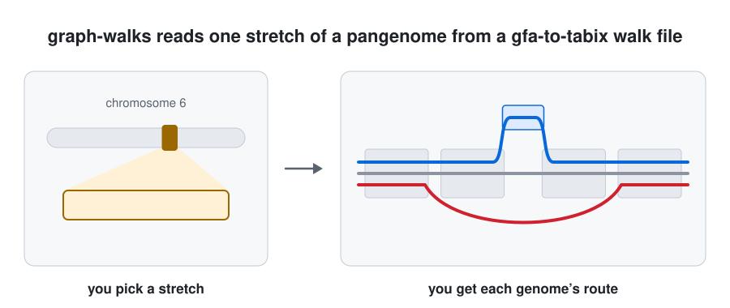

# @jbrowse/graph-walks

`@jbrowse/graph-walks` is the reader for
[gfa-to-tabix](https://github.com/GMOD/gfa-to-tabix)'s pangenome files, as
[@gmod/bam](https://github.com/GMOD/bam-js) is for BAM.

A pangenome graph stores many people's genomes on one reference genome, with a
branch wherever someone's DNA differs. graph-walks fetches only the part under a
stretch of the reference, such as one gene, by range requests, so a genome
browser can draw it.



- **In:** a walk file from `gfa-to-tabix --walks`, or its older segment index,
  and a region such as `chr6:160,614,798-160,647,758`
- **Out:** each haplotype's walk through the region, and the nodes and links
  they visit

Used by the JBrowse graph plugin, BandageJS, jb2hubs, the sequenceTubeMap fork,
ggbandage and ggtubemap.

## Install

```bash
npm install @jbrowse/graph-walks
```

A segment index also needs `@gmod/tabix`.

## Usage

```ts
import { WalkReader, walksKept } from '@jbrowse/graph-walks'

const reader = WalkReader.open(
  'https://jbrowse.org/demos/hprc/hprc-v2.1-mc-grch38-f8.GRCh38.walks.gz',
)

const refName = 'GRCh38#0#chr6'
const { graph, kept, fragments, departures } = await reader.cut(
  refName,
  { start: 160_614_798, end: 160_647_758 },
  { keep: walksKept(['HG00097', 'HG00133'], refName) },
)
const tables = graph.tables(kept, fragments, departures)
```

- `WalkReader.open(url)` reads `url` and `url.idx` by range requests; pass
  `url => new LocalFile(url)` from generic-filehandle2 as a second argument to
  read local files
- `tables` holds the nodes, the links, each walk's steps, and every place a walk
  leaves the reference

## Docs

- [Cutting a window](docs/cutting.md): reader methods, cut options, fragments,
  departures
- [Reads, budgets and abridged walks](docs/reads.md): what a cut fetches
- [Counts](docs/counts.md): haplotypes per node and link
- [Structural forms](docs/structural-forms.md): grouping haplotypes by change
- [Migrating to graph-walks 8](docs/migrating-to-8.md): changes in 7 and 8
- [ADR 0001](docs/adr/0001-a-cut-states-what-lies-between-fragments.md): gaps
  between fragments

## License

MIT
